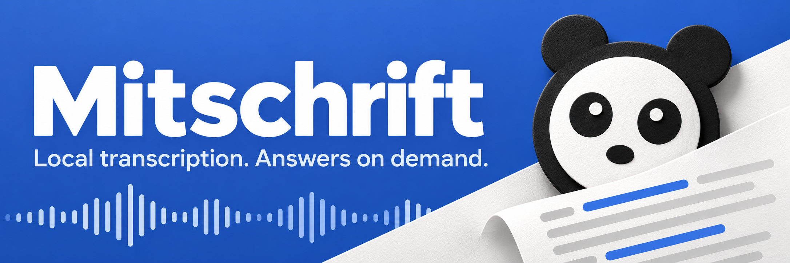
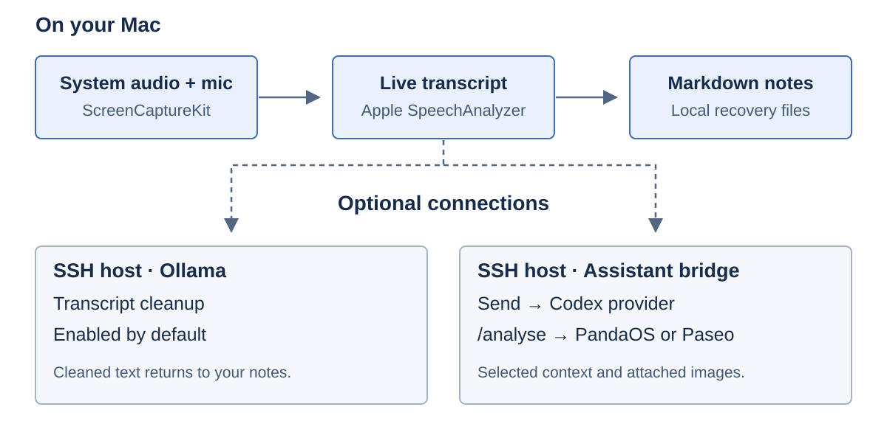

# Meeting notes, straight from your Mac

Mitschrift transcribes your microphone and system audio into timestamped Markdown notes. It works alongside Teams, Slack, Zoom, and browser calls, even when the meeting app has no transcription feature.

Speech recognition runs on your Mac. The transcription pipeline writes text, without saving an audio recording. Optional chat and transcript cleanup have separate data paths, shown below.

[Build and install](#build-and-install) · [Connect PandaOS or Paseo](docs/integration.md) · [Commands and configuration](docs/reference.md)

## During a meeting

| You need to… | Mitschrift gives you… |
| --- | --- |
| Follow the conversation | A live transcript of the last ten minutes, with timestamps and copy controls. |
| Catch a question you missed | An on-demand answer suggestion based on the last four minutes and the latest screen text. |
| Ask a follow-up | A Codex chat with the current transcript, six recent turns, selected notes, and optional images. |
| Keep a shared screen | Window screenshots with local OCR, plus video clips started with an explicit click. |
| Read the meeting later | Markdown notes in your Obsidian vault, with recovery after an interrupted session. |

A panda in the menu bar shows whether Mitschrift is ready, recording, or paused. The floating panda provides recording, screenshot, video, chat, and live-transcript controls. The app runs without a Dock icon.

The current app interface and assistant prompts are in German. Recognition defaults to `de-DE`; the documentation is in English.

## Where your data goes



| Path | What happens |
| --- | --- |
| Transcription | Apple SpeechAnalyzer processes audio on the Mac. Separate microphone and system tracks distinguish you from other participants. |
| Speaker separation | FluidAudio runs locally. Its model downloads from Hugging Face on first use. Labels identify voices, without establishing people's names. |
| Transcript cleanup | **Enabled by default.** Transcript text goes over SSH to Ollama on `structureHost`. Set `structureEnabled` to `false` to skip this step. |
| Chat | Only an explicit send transfers context to the SSH bridge and Codex provider. The prompt asks Codex to read relevant vault notes. Its read-only sandbox does not confine reads to that vault. |
| Images and video | Meeting screenshots are retained by default through `keepScreenshots`. Video starts from its own control. Chat attachments are previewed before you send them. |

`/analyse` transfers context into a persistent agent session. Its transcript excerpts, conversation history, and images follow the host's session storage and retention rules. Manage that session in PandaOS or Paseo; clearing Mitschrift's chat does not delete it.

Local transcription works without PandaOS, Paseo, or Codex. The optional assistant requires adapting the existing bridge. See the [integration guide](docs/integration.md) before using it on another machine.

## Build and install

Use a Mac with macOS 26 or later, Swift 6.2 or later, and an Apple Development signing identity available in your keychain. Python 3 and SSH are needed only for the optional assistant. This repository has no packaged installer.

1. Clone the repository on your Mac and enter its directory.

   ```bash
   git clone https://github.com/marushan491/mitschrifft.git
   cd mitschrifft
   ```

2. Choose your own signing identity, then run the install script in a Mac terminal with an unlocked keychain.

   ```bash
   security find-identity -v -p codesigning
   MITSCHRIFT_SIGN_IDENTITY='Apple Development: YOUR NAME (TEAM ID)' ./build.sh
   ```

   Replace the placeholder with an identity from the first command. The script builds the release binary, replaces `~/Applications/Mitschrift.app`, creates `~/.local/bin/mitschrift`, and restarts the login service. Finish active recordings first. Keep the same signing identity on later builds to preserve permission continuity.

3. Open macOS **System Settings → Privacy & Security** and grant **Screen & System Audio Recording** and **Microphone** access when prompted.

4. Run `mitschrift config`, then edit `~/.config/mitschrift/config.json`. Set `vaultPath` to your destination. Disable remote cleanup if you have no Ollama host.

   ```json
   {
     "vaultPath": "/Users/YOUR_USER/Documents/Meeting notes",
     "structureEnabled": false
   }
   ```

   Merge these example fields into your configuration. Missing fields use defaults. Relaunch Mitschrift after editing. If `mitschrift` is not on your `PATH`, use `~/.local/bin/mitschrift`.

The default notes folder is `50 Resources/Transkripte` inside the configured vault. Obsidian can display the notes and the generated Base as a meeting table. The files remain readable Markdown without Obsidian.

## Connect your assistant

[PandaOS](https://github.com/marushan49/pandaos) is published as a fork of [Paseo](https://github.com/getpaseo/paseo). Use whichever environment you already have.

The [setup guide](docs/integration.md) covers your SSH host, Codex login, vault, CLI path, provider, and analysis workspace. Upstream Paseo supports the session commands used by the bridge. Paths and provider settings need source edits; there is currently no in-app connection wizard.

Normal chat uses an ephemeral, read-only `codex exec` call. It does not create an agent session. The default model is `gpt-6-luna` with `low` reasoning effort; choose a model available to your account when adapting the bridge.

`/analyse <question>` explicitly starts an independent agent session. Its answer and follow-ups stay in that session. Cancelling the wait in Mitschrift does not stop an agent that has already started. Analysis uses the configured provider's normal permissions; the analysis-only prompt is not a hard read-only sandbox.

The **Open analysis in PandaOS** action relies on a PandaOS-specific tab request. With upstream Paseo, open the session manually unless you implement an equivalent action.

## Useful controls

| Action | Control |
| --- | --- |
| Send a chat message | Enter. Use Shift+Enter for a new line. |
| Attach up to four images | Cmd+O, paste, or drag and drop. |
| Capture a chat screenshot | Cmd+Shift+S, then choose a window or region. |
| Capture the meeting window and OCR | `photoHotKey`, default Cmd+Shift+2. |
| Copy | Select text and press Cmd+C, or use the transcript and answer copy buttons. |

Chat receives up to 32,000 characters of recent transcript and six recent question-answer pairs. Truncation preserves complete lines and marks missing earlier context. Up to four recent images accompany a request, with current attachments taking priority. Images are normalized locally to at most 1600 pixels and JPEGs under 2 MB.

Normal chat history stays in Mitschrift's memory. A new chat, a new recording, or an app restart clears it. A new chat also clears the draft. Temporary bridge images are removed after the request; this does not erase inputs retained by the model provider or an independent analysis session.

## Recording behavior and limits

Mitschrift starts after another app uses the microphone for the configured delay. Listed meeting apps can also trigger it through system audio, which covers muted or listen-only calls. Browsers are excluded from that output-trigger list by default. You can start manually, pause automation, save, or discard a session from the menu.

The microphone track filters text that matches nearby system audio to reduce speaker echo. Voice separation falls back to a generic other-participants label if its model fails. Neither mechanism guarantees perfect transcription or identity attribution.

Screen sharing exclusion uses `sharingType = .none`, which Apple has deprecated. Verify the actual behavior in your meeting app before relying on the panda or assistant being hidden. The eye control hides both windows.

Screenshots, OCR, and video can contain meeting content. Obtain participants' permission before recording or transcribing, and follow the rules that apply to your meeting.

## Development

Run native tests on a Mac:

```bash
swift test
```

Run bridge tests without contacting a model:

```bash
PYTHONDONTWRITEBYTECODE=1 python3 -m unittest discover -s Tests -p 'test_*.py'
```

The optional `MITSCHRIFT_CHAT_SMOKE=1 swift test --filter PanelTests.testLiveLunaChatAndFollowUp` check contacts the configured Codex account. `Tests/run_checks.sh` contains a machine-specific remote test workflow; adapt it before running it elsewhere.

[Command and configuration reference](docs/reference.md)
